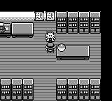
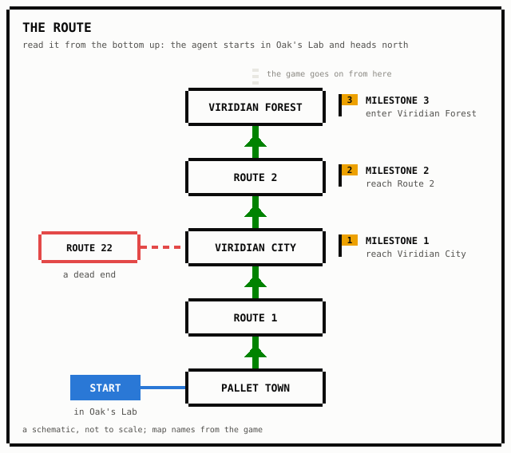
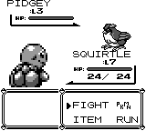

In my [last post](../your-reward-model-is-an-attack-surface/) I wrote about reward hacking: you can't write down exactly what you want, so you reward something close to it, and if you optimize hard enough the reward and what you wanted come apart.
That story is usually told as a curve.
At first the reward and the real goal rise together.
Push harder, and the reward keeps rising while the real goal falls.

I wanted to watch that curve happen with my own eyes, somewhere small enough to run ourselves.
I picked a game I grew up with: Pokémon Red.

It didn't go the way I expected.
The agent mostly didn't cheat, and when we patched the main thing it did game, our fix cost it most of its real progress.

## The question

People have trained agents to play Pokémon Red before, and they all reward something hand-written: exploring, gaining levels, healing [@whidden2023pokemonred; @pleines2025pokemon].
Their write-ups describe agents gaming those rewards.
One got stuck in a loop of near-endless battles to collect a heal reward [@pleines2025pokemon].
Another found pacing loops in 41% of sampled baseline episodes, and cut that to under 5% with hand-tuned anti-loop penalties [@mudireddy2026pokerl].

What the Pokémon write-ups I read don't do is plot the reward against real progress through the game, as training gets stronger.
That's the kind of plot @gao2023scaling made for learned reward models in language-model fine-tuning, and the one I wanted for a game.
So the question was simple: if you pay an agent for exploring, and train it harder and harder, does its real progress eventually fall behind?

## The setup: a score, and a scoreboard the agent never sees

The game runs in an emulator, PyBoy [@pyboy], and we read everything we measure straight out of the game's memory.

The agent starts in Professor Oak's lab, just after getting the Pokédex.

{style="width: 480px; max-width: 100%; height: auto; image-rendering: pixelated;"}

From there the route goes through Pallet Town and Route 1 to Viridian City, then up Route 2 to the entrance of Viridian Forest.
That's our whole segment, with three milestones:

1. reach Viridian City,
2. reach Route 2,
3. enter Viridian Forest.

There's also a tempting dead end, Route 22, to the west of Viridian.

The agent gets a **score**: 0.1 points for every new square it stands on, 1 point per level its Pokémon gains, and a little for healing.
In practice almost all of it comes from new squares.

Separately, we keep a **scoreboard** of real progress: how many of the three milestones the agent reached, in order.
The agent never sees it.
It's trained only on the score, and the scoreboard is how we check whether the score is pointing the right way.

We trained three kinds of player:

- **the agent**, trained on the score;
- **a reference agent**, trained on real progress instead (the milestones, plus a small bonus for getting closer to the next one), to show what this learner can do when it's pointed at the real goal;
- **a random player**, pressing buttons at random, as a baseline for everything.

We also held back two start states the agent never trained on: the same start with a different starter Pokémon, and a start at the Viridian City Pokémon Center door.
Their results stayed sealed until after we had committed to a fix.
More on why that mattered later.

## Batch 1: an agent that learned nothing

The first batch was a flop, in an instructive way.

The agent's score was flat from the very first checkpoint, at about 1.4 times the random player's on average.
Training didn't push it up.

And scored by points alone, the ranking came out backwards: the agent first, the random player second, and the reference agent last (30.4 for random against 15.3 for the reference, averaged over checkpoints), even though the reference was first on real progress.

So was the score just a bad reward?
To find out, we wrote a planner with a perfect memory of where it had been and full knowledge of the map, and had it greedily cover new squares.
It scored at least 417, about eight times the agent's best.
And while doing nothing but chasing new squares, it went right past the end of our segment in 16 out of 16 episodes.

That changed the picture.
On this stretch of the game, **covering the map and following the route are the same thing**.
The score wasn't the problem.
The agent just couldn't learn it.

Looking back, our own pilot run had shown the same thing, and we missed it.
We had checked that the reference agent could learn and that our cheat detectors fired.
We never compared the agent's score with the random player's, or with what was possible.

## The fix: give it a memory

The agent in batch 1 saw only the current screen, as a grid of tiles.
It had no idea which squares it had already visited, and it was being paid for *new* ones.
That's like asking someone to find every room in a house while wiping their memory each time they walk through a door.

For batch 2 we added one input to what the agent sees: a layer marking the squares it had already visited in this episode.
Nothing else changed.

I want to be upfront that this wasn't the original plan.
The plan was one batch, then a patching phase.
We designed batch 2 after seeing batch 1, wrote its rules down before running it, and kept the held-out results sealed throughout.
But it's a second experiment, informed by the first.

We set ourselves a check: the agent's score had to at least double.
It did.
Its best score went from 55.5 to 120.9 on the first start state, and from 50.5 to 121.7 on the second.

## Batch 2: score and progress went up together

Now the agent was really optimizing its score, so this was the batch where the curve should have shown up.

It didn't.
On the first start state the score rose from 64.6 at the 0.5M-step checkpoint to 112.6 at 5M, and real progress rose with it, from 1.05 milestones to 1.43.
In between, progress was bumpy rather than smooth (0.80 at 1M, 1.50 at 2M, 0.93 at 3M, 1.80 at 4M), which fits a point I come back to: single checkpoints are noisy.
On the second start state the score went from 57.1 to 121.7, and progress from 1.40 to 1.95.
The random player, for comparison, scores 29.7.
Score up, progress up, no bend.
How the agent stacks up against the reference agent here depends on a filtering choice about the reference's bad checkpoints, which I come back to in [What didn't work](#what-didnt-work).

That doesn't mean the agent was squeaky clean.
Our detectors found two exploits, both mild, and both traced back to the score rather than to the learner:

- **Wandering off-route.** Collecting new squares on maps behind its furthest milestone, or in side buildings. This carried about 18% of the agent's reward, pooled over checkpoints, and showed up on 8 of 10 runs.
- **The Route 22 detour.** Time on the dead end. About 2% of the reward, pooled the same way.

Both showed up again on the held-out start states.
And neither stopped real progress from going up.

![Where each agent walked outdoors at the 5M-step checkpoint, starting in Oak's Lab. One checkpoint is one sample, and scores swing between checkpoints. Left (40 episodes): the batch-2 agent trained on the score covers Pallet Town, Route 1 and Viridian City densely, and reaches Route 22 and Route 2. Middle (24 episodes): the agent trained on the patched score (it comes up below) mostly stops on Route 1; in four of 24 episodes, all from one run, it continues to Viridian City and Route 2. Right (24 episodes): random play barely leaves Pallet Town. Indoor squares aren't drawn; the strips under each map show which buildings the agent entered. None entered Viridian Forest at this checkpoint.](where-they-went.svg)

My best explanation is the planner's lesson again.
On this stretch the route runs through most of the squares you can reach, so exploring and making progress are mostly the same activity.
At the end of training the agent had covered only about 27% of the squares the planner reaches.
It never ran out of route, so it never had to choose between exploring and progressing.
That's my inference, not something we tested.

## The patch that backfired

The plan always had a second phase: find an exploit, patch the reward, retrain, and see whether the patch holds, including on the held-out starts.
Wandering off-route was the main exploit, so it got the first patch.

The patch capped the exploration reward at the first 20 new squares on each map.
We picked 20 with a rule we'd fixed in advance: of six candidate caps, the largest one that removes at least 80% of the off-route reward.
It removed 85.7%.

It also removed 82.4% of the reward for everything else.
Total reward on the same behavior dropped to 0.17 of what it had been.
We could see before training that the cap was blunt.
We kept it anyway, because the rule was fixed first and changing it after seeing the numbers would defeat the point of having a rule.

Then we trained three new runs on the patched score.
Real progress fell.
At the end of training the three runs reached 0, 0 and 1.0 milestones, an average of 0.33.
Before the patch, five runs on the same start state averaged 1.43 at the same point.

The patched agents did learn their new score, slowly.
But scored by the *original* rules, they earned about 22, which is less than the random player's 29.7.

And the off-route wandering?
Measured on the original score, both before and after, there are two halves to the answer, and both are true.
How *often* the patched agent was on an off-route map dropped to the random player's level.
But the *share* of its reward that came from those maps was 0.174, against 0.169 before the patch on the same start state.
The patch didn't make the agent explore on-route.
It shrank how much the agent explores, to a bit less than random play earns on the original score, and left the mix the same.
Where it goes is different: as the figure above shows, it travels further north than random play.

![Where the score came from, before the patch (the batch-2 agent) and after it (trained on the patched, capped score), pooled over all seven test checkpoints. (a) Each agent's own score by source: before the patch, 99.9% came from exploring; after it, 12% came from levelling up. (b) Measured on the original score, the share earned on off-route maps: 16.9% before, 17.4% after, and 12.2% for random play, all from the first start state. (c) The share of each agent's own score earned while grinding battles in grass: 0.0% before, 22.3% after.](reward-sources.svg)

## Grass grinding

With exploring now paying so little, something else grew to fill the space.

The level reward was untouched by the patch.
By our offline estimate, that made levels about six times more valuable relative to exploring than before.
After the patch, grinding battles against wild Pokémon in tall grass carried 22% of the patched reward across the three runs, and it showed up on two of them.
Before the patch, the agent did that in none of its 560 test episodes.

{style="width: 480px; max-width: 100%; height: auto; image-rendering: pixelated;"}

I'm careful not to say the patch *caused* the grinding.
This round had no reference agent to compare against, and the reference agent ground in grass in batch 2 too.
What I can say is that grinding grew after the patch, on two of three runs.

The three runs also behaved differently from each other, not just by different amounts.
One made progress early and then settled into grinding.
One never made progress at all.
One made progress at four checkpoints and never ground.
Three runs can't tell us which of those is typical.

## Why we stopped

The rule we'd written in advance said to patch again: a new behavior had appeared, and real progress was below the reference agent's, at least if you drop the reference's collapsed checkpoints, the ones where it had fallen back by a milestone or more (more on those [below](#what-didnt-work)). Count them, and the rule would have said stop.

I stopped anyway, and the paper lists it as a deviation from the plan.
Under the patched score, the agent already earned less of the original score than random play.
A second patch stacked on top would be tested on a learner that barely worked, and it couldn't tell "the patch worked" from "the agent was starved of reward" any better than this round could.

The held-out results, opened only after that decision was logged, told the same story on the different-starter start.
The other held-out start, at the Viridian City Pokémon Center door, was worse.
There the patched agent earned less than random play on either score: 3.58 points of patched reward at 5M steps, against the random player's 7.77.
The unpatched batch-2 agent had done fine from that start.
My guess, and it's only a guess, is that an agent trained under the cap learns to fill its quota of new squares on the maps around its own start.
The useful next experiment is a different patch: one that targets off-route exploring specifically, starting again from the original score.
We haven't run it.

## What didn't work

Here's the honest list, in one place.

- **No curve here isn't no curve anywhere.** The main hypothesis came out inconclusive in both batches, not disproved. This is one stretch of one game, one kind of reward, one training algorithm, and 5 runs per setting.
- **Batch 2 was designed after seeing batch 1.** We wrote its rules down first, but it's a follow-up.
- **The reference agent was unstable.** 13 of its 40 late checkpoints had collapsed, falling back by at least a milestone. Whether the reference beats our agent on real progress flips depending on whether those collapsed checkpoints are dropped. We fixed the rule in advance (drop them), and we report both.
- **A frozen checkpoint isn't the learner.** Our agent's training episodes scored two to three times what its frozen checkpoints did. When we resumed learning from a checkpoint that scored about 50, it scored 131 in its first episodes. Much of the score is earned by the agent adapting as it goes.
- **Checkpoint scores are noisy.** The same run's score ranged from 0.40 to 1.25 of its own late average across 20 extra checkpoints. A dip at 3M steps in 8 of 10 runs is still unexplained. We guessed at a cause, wrote the prediction down, and the guess failed.
- **The patch round is small.** Three runs on one start state, no reference agent, and two judgment calls made after seeing data: which reading of the stopping rule let the round run at all, and stopping after it.

## What I learned

The gap between the score and the real goal was there the whole time.
The score pays for wandering, and the agent did wander, a little.
But the part that would have fooled us wasn't the agent.
It was our instruments.

A checkpoint scored differently depending on when we took it.
The agent behaved differently while it was still learning than when we froze it.
The reference we trusted to say what "good" looks like collapsed in a third of its late checkpoints.
Anyone checking the agent with just one of those would have been misled more by the measurement than by the agent.

The clearest picture of the reference's problem is three of its runs in batch 2.
Earlier in training, each had made it to Route 2 or into Viridian Forest.
By the end, in all 8 of 8 test episodes, the same agent never left Oak's Lab.
We re-ran one of them bit for bit on two other machines and got the same thing, so it wasn't a glitch in the hardware or the evaluation.
It's what the trained weights do.
We still don't know why.

The good news is that every one of those problems showed up because we went looking, and each one changed how we work:

- **Check that the agent is learning its own reward before asking whether it's gaming it.** Compare its score with random play and with what's possible. That's the check that would have caught batch 1 in the pilot, and from batch 2 on we ran it early, at 1M and 2.5M steps.
- **Look at the learning process, not just snapshots.** From batch 2 on, we reported training episodes next to the frozen checkpoints.
- **A detector that reads the reward has to be rebuilt when the reward changes.** After the patch, our off-route detector still flagged "off-route" under the new score, but random play didn't flag at all, because the cap had removed exactly the reward the detector was looking for. We re-ran it under the original score to see what the agent was actually doing.
- **Seal the test set from whoever designs the fix.** The held-out starts stayed closed until the patch was locked in, so they could say something about it.

And the patch round is the part I'll remember.
A blunt fix closed the gap by paying less for everything, and on two of three runs the agent moved over to the next thing that still paid.

The whole experiment ran on about $70 of free Google Cloud trial credit (an estimate from VM uptime, not a bill), about $5 of it for the patch round.
The full write-up with every number is in the paper, and the story of how a team of AI agents built and ran it is in a separate [build-log post](../running-a-pokemon-experiment-with-an-agent-team/).<!-- link live only once both are published -->

## References

::: {#refs}
:::
